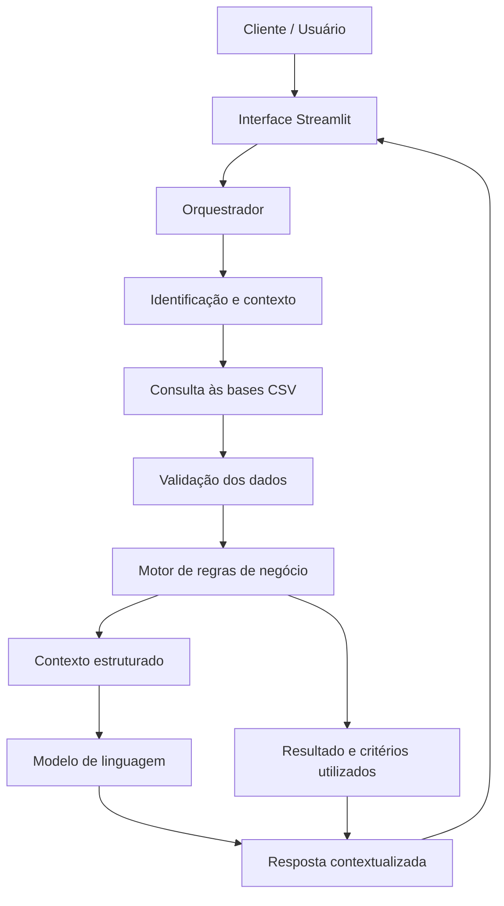

# 🏦 Nexo — Assistente de Crédito Bancário Inteligente

> Agente de Inteligência Artificial Generativa aplicado ao atendimento bancário, à análise inicial de elegibilidade ao crédito e à consulta contextual de informações financeiras.

## 💡 O que é o Nexo?

O Nexo é um assistente bancário inteligente desenvolvido para interpretar informações financeiras estruturadas, consultar produtos bancários e apoiar a avaliação inicial de elegibilidade ao crédito.

O projeto combina **IA Generativa, bases de dados estruturadas e regras de negócio** para produzir respostas personalizadas, objetivas e fundamentadas nas informações disponíveis.

Diferentemente de um chatbot convencional, o Nexo considera o contexto do cliente, seu histórico de movimentações, o perfil financeiro e os atendimentos anteriores para responder às solicitações.

### O que o Nexo faz?

- ✅ Consulta informações cadastrais e financeiras disponíveis.
- ✅ Verifica critérios iniciais de elegibilidade para produtos de crédito.
- ✅ Consulta um catálogo de produtos financeiros e seus requisitos.
- ✅ Utiliza o histórico de movimentações para contextualizar dúvidas financeiras.
- ✅ Considera o perfil do cliente e seus objetivos financeiros.
- ✅ Recupera informações relevantes de atendimentos anteriores.
- ✅ Identifica informações ausentes e sinaliza pendências.
- ✅ Explica os critérios utilizados e indica os próximos passos.
- ✅ Aplica regras de prevenção a respostas inventadas (*anti-hallucination*).

### O que o Nexo NÃO faz?

- ❌ Não garante aprovação de crédito.
- ❌ Não substitui os sistemas oficiais de decisão da instituição financeira.
- ❌ Não inventa taxas de juros, limites, parcelas ou condições comerciais.
- ❌ Não considera o score de crédito como único critério de decisão.
- ❌ Não trata movimentações bancárias como comprovação automática de renda.
- ❌ Não compartilha informações financeiras de terceiros.
- ❌ Não executa transações bancárias sem autorização e integração apropriadas.

**Importante:** este projeto utiliza bases demonstrativas e parâmetros ilustrativos. Os dados e critérios não representam necessariamente as políticas oficiais de uma instituição financeira.

---

## Documentação Completa

Toda a documentação técnica, estratégias de prompt e casos de teste estão disponíveis na pasta [`docs/`](./docs/).

## 🎯 Objetivo do projeto

Desenvolver um agente inteligente capaz de integrar dados financeiros, regras de negócio e modelos de linguagem para melhorar a experiência de atendimento e apoiar análises preliminares de crédito.

O projeto explora aplicações práticas de IA Generativa em um contexto financeiro, com foco em:

- Análise inicial de elegibilidade ao crédito.
- Consulta e interpretação de dados estruturados.
- Automação do atendimento bancário.
- Personalização de respostas com base no contexto do cliente.
- Rastreabilidade das informações utilizadas.
- Redução de respostas inconsistentes e informações inventadas.

---

## 🏗️ Arquitetura

O Nexo foi planejado com uma arquitetura modular, separando a interface, o modelo de linguagem, as bases de dados e o motor de regras.



### Como funciona?

1. **Entrada:** o usuário faz uma pergunta sobre crédito, produtos financeiros ou informações da conta.
2. **Identificação:** o sistema identifica o cliente no ambiente autorizado.
3. **Consulta:** O acesso somente as bases necessárias para responder.
4. **Validação:** o sistema verifica a consistência e a disponibilidade dos dados.
5. **Motor de regras:** critérios objetivos são avaliados conforme os parâmetros cadastrados.
6. **Geração de resposta:** o modelo de linguagem transforma os resultados em uma explicação clara e contextualizada.
7. **Retorno:** o Nexo informa o resultado preliminar, as limitações e os próximos passos.

O modelo de linguagem é responsável pela comunicação e interpretação contextual. As verificações numéricas e as regras objetivas devem ser executadas por componentes determinísticos sempre que possível.

---

## 🧰 Tecnologias e ferramentas

| Tecnologia | Aplicação no projeto |
|---|---|
| Streamlit | Interface conversacional e visualização dos resultados |
| CSV | Armazenamento demonstrativo dos dados |
| Ollama | Geração de respostas com modelos de linguagem |
| GitHub | Versionamento, documentação e portfólio |
| Mermaid | Representação visual da arquitetura |

A arquitetura permite começar com uma execução local e evoluir para APIs, bancos de dados e integrações autorizadas.

---

## 📁 Estrutura do projeto

```text
nexo-assistente-bancario/
│
├── datas/
│   ├── 01_parametros_cliente.csv
│   ├── 02_historico_movimentacoes.csv
│   ├── 03_perfil_cliente.csv
│   ├── 04_historico_atendimento.csv
│   └── 05_catalogo_produtos_financeiros.csv
│
├── docs/
│   ├── 01-documentacao-agente.md
│   ├── 02-base-conhecimento.md
│   ├── 03-prompts.md
│   ├── 04-metricas.md
│   └── 05-pitch.md
│
├── src/
│   ├── app.py
│   ├── data_loader.py
│   ├── credit_rules.py
│   └── agent.py
│
├── tests/
│   ├── test_credit_rules.py
│   └── test_data_validation.py
│
├── .gitignore
├── requirements.txt
├── .env.example
└── README.md
```

### Descrição dos principais arquivos

**`data/` — Bases de conhecimento**

- `01_parametros_cliente.csv`: score, relacionamento, cadastro, renda e informações de elegibilidade.
- `02_historico_movimentacoes.csv`: entradas, saídas, saldos e categorias de movimentação.
- `03_perfil_cliente.csv`: segmento, objetivos e necessidades financeiras.
- `04_historico_atendimento.csv`: solicitações anteriores, respostas e pendências.
- `05_catalogo_produtos_financeiros.csv`: produtos, requisitos, documentação e parâmetros de referência.

As bases compartilham o identificador `client_id`, permitindo cruzar informações do mesmo cliente.

**`src/` — Aplicação**

- `app.py`: interface do usuário.
- `data_loader.py`: carregamento e validação das bases.
- `credit_rules.py`: avaliação dos critérios objetivos de elegibilidade.
- `agent.py`: orquestração das consultas e geração das respostas.

**`docs/` — Documentação**

Contém a descrição do caso de uso, a estratégia de dados, os prompts, as métricas de avaliação e a apresentação do projeto.

**`tests/` — Testes**

Reúne testes para verificar regras de elegibilidade, consistência dos dados e comportamentos esperados do agente.

---

## 🗃️ Bases de conhecimento

O projeto utiliza cinco bases demonstrativas para simular o contexto de atendimento bancário.

| Base | Finalidade |
|---|---|
| Parâmetros do cliente | Identificar características relevantes para a análise inicial |
| Histórico de movimentações | Contextualizar entradas, saídas e padrões financeiros |
| Perfil do cliente | Entender objetivos e necessidades |
| Histórico de atendimento | Manter continuidade entre solicitações |
| Catálogo de produtos | Consultar requisitos e características dos produtos |

A consulta é contextual: uma pergunta sobre empréstimo pode exigir os parâmetros do cliente, o catálogo de produtos e dados de capacidade financeira. Uma pergunta sobre gastos pode exigir principalmente o histórico de movimentações.

**Governança dos dados:** as bases deste repositório devem conter somente informações fictícias ou devidamente anonimizadas. Não devem ser publicados dados reais de clientes, credenciais, documentos ou informações bancárias confidenciais.

---

## 🧠 Estratégia de prompts

O comportamento do Nexo é definido por um *System Prompt* que estabelece identidade, objetivo, regras de segurança, fontes de informação e padrões de resposta.

A estratégia combina:

- **System Prompt:** define o comportamento permanente do agente.
- **Contexto dinâmico:** fornece os dados relevantes do cliente para cada solicitação.
- **Few-Shot Prompting:** apresenta exemplos de perguntas e respostas esperadas.
- **Regras determinísticas:** verificam critérios objetivos antes da geração da resposta.
- **Validação de saída:** reduz o risco de apresentar informações sem respaldo nos dados.

O modelo deve distinguir entre elegibilidade inicial, encaminhamento para análise, pré-aprovação formal e aprovação definitiva.

A documentação completa dos prompts e dos exemplos de interação está em [`docs/03-prompts.md`](./docs/03-prompts.md).

---

## 🚀 Como executar

### 1. Pré-requisitos

- Bases CSV do projeto.
- Um modelo de linguagem local via Ollama ou uma API de modelo compatível.

### 2. Clonar o repositório

```bash
git clone https://github.com/SEU-USUARIO/nexo-assistente-bancario.git
cd nexo-assistente-bancario
```

Substitua `SEU-USUARIO` pelo nome da sua conta no GitHub.

### 3. Criar um ambiente virtual

No Windows:

```bash
.venv\Scripts\activate
```

No Linux ou macOS:

```bash
source .venv/bin/activate
```

### 4. Instalar as dependências

```bash
pip install -r requirements.txt
```

As dependências iniciais podem incluir:

```text
streamlit
pandas
requests
```

### 5. Configurar o modelo de linguagem

**Opção A — Modelo local com Ollama**

Instale o Ollama pelo site oficial e baixe um modelo compatível com a sua máquina. O nome do modelo utilizado deve corresponder ao que estiver instalado.

Exemplo de comandos, após instalar o Ollama:

```bash
ollama pull gpt-oss
ollama serve
```

Se o serviço já estiver em execução, não é necessário iniciar outra instância.

**Opção B — API de modelo de linguagem**

Configure a chave de API em uma variável de ambiente ou em um arquivo `.env` local. Nunca inclua a chave no código, no README ou nos arquivos publicados no GitHub.

O suporte efetivo a cada opção depende da implementação do módulo `agent.py`.

### 6. Executar a aplicação

```bash
streamlit run src/app.py
```

A interface será disponibilizada no endereço local indicado pelo Streamlit.

> Os comandos acima descrevem a configuração prevista para o projeto. A execução completa depende da implementação dos módulos e da presença das bases na estrutura indicada.

---

## 💬 Exemplos de uso

### Exemplo 1 — Elegibilidade para cartão

**Pergunta:**

> Com meu perfil, posso solicitar um cartão de crédito?

**Resposta esperada:**

> Com base nos dados disponíveis, você atende aos critérios iniciais de score e tempo de relacionamento para análise do cartão. A aprovação e o limite dependem da validação completa do cadastro, da capacidade de pagamento e das regras oficiais da instituição.

### Exemplo 2 — Solicitação de empréstimo

**Pergunta:**

> Posso conseguir um empréstimo de R$ 10.000?

**Resposta esperada:**

> Posso verificar sua elegibilidade inicial para empréstimo pessoal. Para confirmar se o valor solicitado pode ser atendido, é necessário avaliar a capacidade de pagamento, os critérios do produto e as condições da proposta. Não é possível confirmar a aprovação apenas com o score.

### Exemplo 3 — Movimentações financeiras

**Pergunta:**

> Quanto gastei no período analisado?

**Resposta esperada:**

> Vou consultar seu histórico de movimentações e somar as saídas registradas no período solicitado. Transferências entre contas próprias e outras movimentações que possam gerar dupla contagem devem ser identificadas antes de apresentar o total consolidado.

### Exemplo 4 — Informações indisponíveis

**Pergunta:**

> Qual será a taxa do meu financiamento?

**Resposta esperada:**

> Não encontrei informações suficientes para confirmar a taxa aplicável à sua proposta. O valor deve ser consultado em uma simulação ou oferta oficial, considerando as condições vigentes e a análise do cliente.

Os resultados reais dependem dos dados consultados, das regras implementadas e das integrações disponíveis.

---

## 📊 Métricas de avaliação

A qualidade do Nexo deve ser avaliada com testes reproduzíveis, incluindo perguntas esperadas, dados de referência e critérios de aprovação.

| Métrica | O que avalia |
|---|---|
| Assertividade | A resposta atende corretamente à pergunta? |
| Fidelidade aos dados | As informações apresentadas estão sustentadas pelas bases? |
| Segurança | O agente evita expor dados indevidos ou executar ações não autorizadas? |
| Consistência | Perguntas equivalentes produzem resultados compatíveis com as mesmas regras? |
| Precisão das regras | Os critérios de elegibilidade são aplicados corretamente? |
| Tratamento de incerteza | O agente identifica informações ausentes ou conflitantes? |
| Latência | Quanto tempo a aplicação leva para responder? |

Os resultados devem ser medidos durante os testes. Não se devem divulgar percentuais de precisão ou desempenho sem evidências experimentais.

---

## 🔒 Segurança e limitações

O Nexo é um protótipo de demonstração, não um sistema bancário de produção.

Os principais cuidados incluem:

- Utilizar dados fictícios nas bases públicas.
- Proteger chaves de API com variáveis de ambiente.
- Excluir arquivos `.env` e credenciais do controle de versão.
- Validar os dados antes de realizar cálculos.
- Restringir o acesso a informações de cada cliente.
- Manter critérios de crédito versionados e rastreáveis.
- Separar a geração de linguagem da decisão objetiva.
- Exigir autenticação, autorização e integrações apropriadas para operações reais.

O uso de um modelo local pode reduzir a transmissão de dados a provedores externos, mas não garante segurança por si só. Logs, permissões, configurações e armazenamento também precisam ser protegidos.

---

## 🌟 Diferenciais do projeto

- **Contextualização financeira:** integra parâmetros, movimentações, perfil e histórico de atendimento.
- **Análise inicial de crédito:** aplica regras objetivas antes de formular uma resposta.
- **Anti-alucinação:** não inventa condições comerciais nem confirma aprovações sem evidência.
- **Arquitetura modular:** separa interface, dados, regras e modelo de linguagem.
- **Rastreabilidade:** permite evoluir para registrar fontes, versões das políticas e critérios aplicados.
- **Flexibilidade tecnológica:** permite avaliar modelos locais ou APIs, conforme a implementação.
- **Aplicação prática de dados:** demonstra o uso de regras de negócio e IA Generativa em um cenário financeiro.

---

## 📚 Documentação

A documentação técnica do projeto será organizada nos seguintes arquivos:

- [Documentação do agente](./docs/01-documentacao-agente.md)
- [Estratégia da base de conhecimento](./docs/02-base-conhecimento.md)
- [Prompts e exemplos de interação](./docs/03-prompts.md)
- [Métricas e plano de testes](./docs/04-metricas.md)
- [Pitch e apresentação do projeto](./docs/05-pitch.md)

---

## 🛣️ Próximas etapas

- [ ] Publicar a estrutura inicial do repositório.
- [ ] Organizar as cinco bases CSV na pasta `data/`.
- [ ] Finalizar a documentação técnica em
